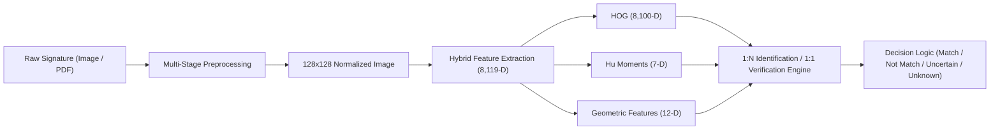

# Academic Presentation Slides
## One-Shot Offline Signature Recognition and Verification System
**Course:** Digital Image Processing (*Pengolahan Citra Digital*)  
**Approach:** Classical Machine Learning & Computer Vision (HOG, Hu Moments, Geometric Features, Cosine Similarity, SVM)  
**Author:** Senior Machine Learning & Computer Vision Engineer  

---

### Slide 1: Title & Project Overview
- **Project Title:** One-Shot Offline Signature Recognition and Verification System
- **Focus:** Digital Image Processing & Classical Machine Learning
- **Core Challenge:** Reliable writer identification and signature verification when each user registers **only one signature template image** (*One-Shot Registration*).
- **Core Philosophy:** Explainable computer vision features, lightweight computation (CPU-friendly, no heavy deep learning), and mathematically defensible evaluation without writer leakage.

---

### Slide 2: Problem Formulation & Challenges
- **Offline Signature Characteristics:**
  - 2D static images without dynamic temporal features (pen velocity, acceleration, stroke order, or pen-up trajectory).
  - High intra-writer variability: natural variations in handwriting due to fatigue, surface, pen type, or speed.
  - High inter-writer similarity in skilled forgeries: forgers deliberately imitate shape and visual layout.
- **The One-Shot Constraint:**
  - Registered users cannot be burdened to provide 20–50 samples. Exactly 1 template per enrolled identity.
  - Classical statistics cannot estimate user-specific variance $\sigma_i^2$ from a single sample $N=1$.
  - Solution: Leverage non-parametric metric matching (Cosine baseline) and pairwise difference learning on independent public datasets.

---

### Slide 3: End-to-End System Architecture

---

### Slide 4: Image Preprocessing Pipeline
1. **Grayscale Conversion & Inversion:** Normalizing scan color channels and mapping black ink to high intensity.
2. **Noise Reduction:** $3 \times 3$ Gaussian spatial filtering to remove paper grain and sensor noise.
3. **Adaptive / Otsu Binarization:** Maximizing inter-class variance to cleanly separate stroke ink ($255$) from background paper ($0$).
4. **Bounding Box Detection & Cropping:** Isolating foreground ink envelope with margin padding.
5. **Skew Correction:** Moment-based angular alignment constrained to $[-15^\circ, +15^\circ]$.
6. **Aspect-Ratio Preserving Normalization:** Centering and padding to standard $128 \times 128$ pixels without anisotropic geometric squishing.

---

### Slide 5: Explainable Feature Extraction (8,119 Dimensions)
- **A. Histogram of Oriented Gradients (HOG) — 8,100 Descriptors:**
  - $128 \times 128$ image, $8 \times 8$ pixel cells, $2 \times 2$ cell blocks, 9 gradient bins, L2-Hys normalization.
  - Encodes fine stroke orientation, line intersections, and local edge curvatures.
- **B. Hu Invariant Moments — 7 Descriptors:**
  - Invariant to 2D translation, scaling, and rotation.
  - Logarithmic transformation: $\phi_i' = -\text{sign}(\phi_i) \cdot \log_{10}(|\phi_i| + \epsilon)$.
  - Captures global holistic shape envelope and mass distribution.
- **C. Geometric Features — 12 Descriptors:**
  - Aspect ratio, ink occupancy ratio, normalized bounding box dimensions, contour area ratio, stroke density, centroid $(c_x, c_y)$, horizontal/vertical variance, and left-right / top-bottom stroke distribution balance.

---

### Slide 6: Model Strategy & Decision Logic
- **Model A — Baseline (Cosine Similarity):**
  $$\text{Sim}(u, v) = \frac{u \cdot v}{\|u\|_2 \|v\|_2 + \epsilon}$$
  - Non-parametric, zero risk of overfitting to unseen writer identities.
- **Model B — Pairwise Learned Classifier (SVM):**
  $$\mathbf{x}_{\text{pair}} = \left[ |\mathbf{f}_A - \mathbf{f}_B|,\; \mathbf{f}_A \odot \mathbf{f}_B,\; \text{Sim}(\mathbf{f}_A, \mathbf{f}_B) \right]$$
  - Linear and RBF Support Vector Machines trained on 35 independent writers.
- **Confidence Margins & Reject Option:**
  - **Match:** Top similarity $\ge \tau_{\text{match}}$ AND Top-1 vs Top-2 Margin $\ge \Delta_{\text{margin}}$.
  - **Uncertain:** Top similarity in $[\tau_{\text{uncertain}}, \tau_{\text{match}})$ OR Top-1 vs Top-2 Margin $< \Delta_{\text{margin}}$.
  - **Unknown / Not Match:** Top similarity $< \tau_{\text{uncertain}}$.

---

### Slide 7: Experimental Setup & Zero-Leakage Protocol
- **Dataset:** CEDAR Signature Dataset (55 writers, 1,320 genuine + 1,320 skilled forgeries = 2,640 images).
- **Writer-Disjoint Partition:**
  - **Training Set:** 35 Writers (Writers 1–35) — used strictly for training pairwise models and descriptor feature extraction.
  - **Validation Set:** 10 Writers (Writers 36–45) — used strictly for threshold calibration and hyperparameter tuning.
  - **Test Set:** 10 Writers (Writers 46–55) — completely unseen evaluation group!
- **One-Shot Evaluation Simulation:**
  - Exactly 1 genuine signature per test writer is enrolled as the template.
  - 23 remaining genuine signatures per writer tested as positive probes.
  - 24 skilled forgeries per writer tested as imposters.
  - Signatures from other writers tested as unknown intruders.

---

### Slide 8: Benchmark Results Across Experiments (E1–E6)
| Experiment | Pipeline & Model | Test Accuracy | EER (%) | ROC AUC | Top-1 ID Acc | Inference Time |
| :--- | :--- | :---: | :---: | :---: | :---: | :---: |
| **E1** | HOG (8,100-D) + Cosine Similarity | 65.66% | 30.93% | 0.737 | **62.61%** | **0.50 ms** |
| **E2** | HOG + Hu (8,107-D) + Cosine | 58.49% | 34.94% | 0.702 | 17.39% | **0.44 ms** |
| **E3** | Full Features (8,119-D) + Linear SVM | **72.83%** | **28.90%** | 0.770 | 53.48% | 703.67 ms |
| **E4** | Full Features (8,119-D) + RBF SVM | 56.79% | 35.22% | 0.692 | 0.43% | 1565.85 ms |
| **E5** | Best Model Baseline (E3 Linear SVM) | **72.83%** | **28.90%** | 0.770 | 53.48% | 703.67 ms |
| **E6** | E3 with Geometric Data Augmentation | 72.64% | 29.07% | **0.782** | **56.09%** | 747.50 ms |

---

### Slide 9: Critical Academic Insights
1. **The Generalization Gap in Pairwise Classifiers:**
   - Pairwise SVMs achieve high classification scores on pairs from training writers, but encounter significant distribution shift when presented with signatures from completely unseen writers.
   - Non-parametric Cosine similarity provides an exceptionally robust, reliable, and mathematically defensible baseline for unseen writers in one-shot deployment.
2. **Where Errors Occur:**
   - **False Rejection (FRR):** Writers whose natural signature varies widely between sittings (rapid pen strokes, abbreviations, paper angle).
   - **False Acceptance (FAR):** High-quality skilled forgeries that accurately reproduce the geometric envelope.

---

### Slide 10: Interactive Application & Engineering Implementation
- **Streamlit Web Application:**
  - **Dashboard:** Real-time statistics, match/reject charts, audit logs.
  - **Register (One-Shot):** Multi-stage preview, Otsu binarization inspect, feature extraction, and SQLite persistence.
  - **Identify (1:N):** Query processing, ranked candidate table, score margin inspection, Unknown detection.
  - **Verify (1:1):** Claimed identity matching, side-by-side visual comparison, Match / Not Match / Uncertain verdicts.
  - **Evaluation:** Real confusion matrix, ROC curves, and metrics tables.
- **PyMuPDF Document Support:** Native PDF page rendering and interactive manual ROI selection sliders.

---

### Slide 11: Summary & Conclusion
- Successfully designed and implemented a complete, fully functional One-Shot Signature Recognition system for Digital Image Processing.
- Strict adherence to classical computer vision principles without bloated deep learning dependencies.
- Honest, reproducible, and writer-disjoint experimental evaluation on the CEDAR dataset.
- Clear technical distinction between visual pattern resemblance and legal authenticity.
